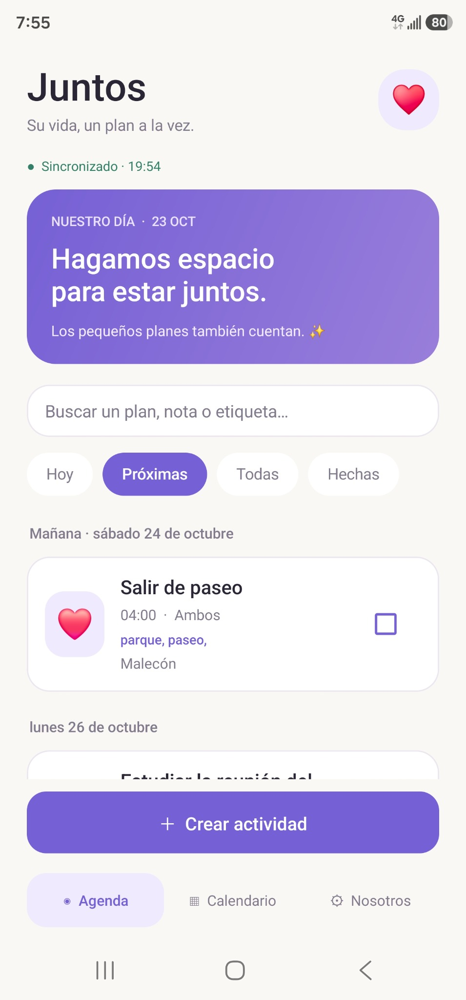
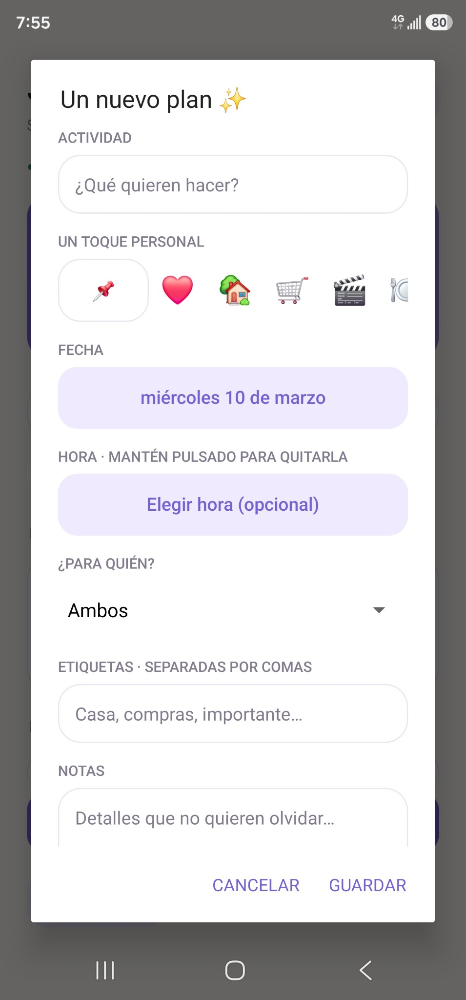
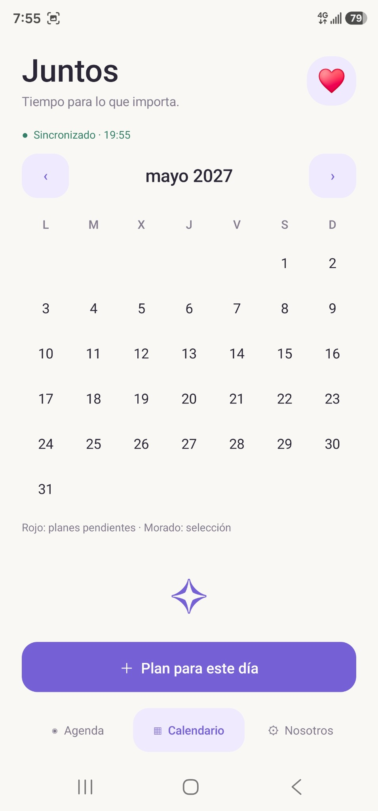
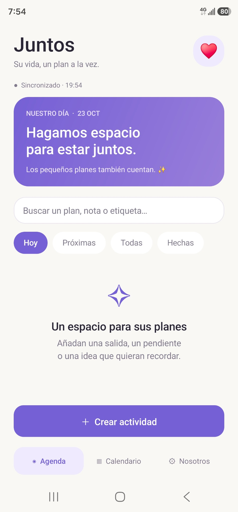

<p align="center">
  
</p>

<h1 align="center">Juntos · Agenda en pareja</h1>

<p align="center"><strong>Sus planes, en un mismo lugar.</strong><br>
Organicen actividades, fechas y pendientes; ambos pueden editar su agenda compartida.</p>

<p align="center">
  <a href="https://github.com/Salvador9797/juntos/releases/latest">Descargar APK para Android</a> ·
  <a href="https://juntos-agenda-en-pareja.eagerwand17.chatgpt.site/guia.html">Cómo empezar</a> ·
  <a href="https://juntos-agenda-en-pareja.eagerwand17.chatgpt.site/privacidad.html">Privacidad</a>
</p>

## Así se ve Juntos

Capturas reales de la aplicación Android. Pulsa una imagen para verla en tamaño completo.

<table>
  <tr><th>Sus próximos planes</th><th>Crear una actividad</th><th>Calendario compartido</th></tr>
  <tr>
    <td></td>
    <td></td>
    <td></td>
  </tr>
</table>

<details>
<summary>Ver pantalla de inicio</summary>



</details>

**¿Para qué sirve?** Para acordar una salida, preparar compras, recordar una fecha o repartir pendientes cotidianos. Añadan notas, emojis, etiquetas y listas de tareas a cada actividad.

**¿Cómo se comparte?** La agenda funciona localmente sin conexión. Para compartirla, configuren su propio bot de Telegram y dos canales privados; después, el segundo celular se vincula por QR. La sincronización necesita internet y las copias se cifran antes de enviarse. No hace falta una cuenta de Juntos.

Agenda Android para organizar actividades en pareja. Software libre bajo
[Apache License 2.0](LICENSE). Android 8 o posterior. Versión 0.3.2, publicada como estable en GitHub.

[Página y descarga](https://juntos-agenda-en-pareja.eagerwand17.chatgpt.site/)
· [Privacidad](https://juntos-agenda-en-pareja.eagerwand17.chatgpt.site/privacidad.html)
· [Código y compilación](https://juntos-agenda-en-pareja.eagerwand17.chatgpt.site/codigo/)

**F-Droid: [solicitud #4605 enviada](https://gitlab.com/fdroid/rfp/-/work_items/4605), pendiente de revisión.**

## Funciones

- Actividades con fecha, hora opcional, notas, etiquetas, emoji y responsable.
- Agenda, búsqueda, calendario con días pendientes destacados en rojo.
- Listas de tareas, recordatorios con avisos exactos opcionales y repeticiones.
- Historial y papelera locales y copias exportadas cifradas.
- Widget, avisos de cambios y vinculación por QR sin PIN adicional.
- Asistente guiado que conserva el progreso de configuración.
- Uso local sin conexión; sincronización opcional mediante Telegram.

Cada pareja configura su propio bot, dos canales privados y una clave de
cifrado. Una persona prepara la conexión y la otra se une mediante QR.
La APK no contiene el token del creador ni credenciales compartidas entre
parejas. **El QR sí contiene acceso completo a la agenda de origen**;
solo debe mostrarse a la persona que se va a vincular.

## Compilar

JDK 17, Android SDK 35, Build Tools 34.0.0 y Gradle 8.9. Configura ANDROID_HOME
o un `local.properties` local con `sdk.dir`. Ejecuta:

```sh
./gradlew assembleRelease
```

El resultado sin firma queda en `app/build/outputs/apk/release/`.
Para pruebas locales, `./gradlew assembleDebug` utiliza la firma de depuración
generada por Android. Las claves privadas de publicación no están en este
repositorio. Consulta [publicación y firma](docs/PUBLICATION.md).

## Qué se ha comprobado

Compilación, Android Lint, cifrado autenticado, comparación de revisiones,
recurrencias, reglas del asistente, invitaciones y asignación A/B. El QR se
comparó con un generador independiente. Pruebas JVM en `tests/`.

La sincronización de extremo a extremo, el recorrido completo de configuración,
las notificaciones bajo restricciones de batería y el widget aún requieren
más pruebas en teléfonos reales con bots y canales reales. No se presenta
como una aplicación auditada de forma independiente.

## Límites importantes

- Sincroniza cada 30 segundos en pantalla y mediante tareas de Android en
  segundo plano desde intervalos de 15 minutos; pueden retrasarse.
- Los recordatorios usan alarmas exactas si el usuario concede el acceso en
  Android 12 o superior. Sin el permiso son aproximados. La actividad debe
  haber llegado al celular; no se necesita internet para el aviso local.
- Nosotros → Avisos y batería permite revisar permisos, abrir ajustes y
  probar una notificación en un minuto. Hay recuperación local periódica.
- Forzar la detención impide el trabajo en segundo plano hasta volver a abrir
  la app. Las restricciones del fabricante también pueden impedir avisos.
- Las ediciones simultáneas de una misma actividad no se combinan por campo.
  Prevalece una revisión; las versiones observadas pueden recuperarse desde
  el historial local, sujeto a sus límites.
- El historial no es un registro completo compartido.
- La copia actual de Telegram se actualiza en el mensaje fijado de cada canal.
  No se garantiza el borrado definitivo de archivos antiguos o sustituidos.
- Telegram puede observar datos técnicos y metadatos, aunque los documentos
  de la agenda se cifran antes de enviarse.
- Conservar una exportación y su clave es necesario para recuperar datos.

No incluye publicidad, compras, suscripciones ni SDKs de seguimiento.
Una edición premium es una posibilidad futura, no una función actual.

## Participación

Este proyecto acaba de iniciar su publicación. No se ha habilitado un
buzón de incidencias propio. La propuesta de inclusión y sus datos se
encuentran en `fdroid/`; cualquier estado de envío debe verificarse en
la página del proyecto. No publiques tokens, claves ni QR al pedir ayuda.

## Notas que se convierten en lista (0.3.2)

Al guardar una actividad, las notas con dos o más renglones cortos se convierten
en casillas dentro de esa misma actividad. Por ejemplo, `10 tomates` conserva
la cantidad. También se aceptan viñetas, numeración (`1.` o `1)`) y casillas
`[x]` / `[ ]`. Las casillas importadas marcadas siguen completadas.
El editor muestra el número de renglones detectados y permite desactivar la
conversión para esa actividad. Los párrafos separados por una línea vacía,
las frases completas sin viñetas y los renglones largos se conservan como notas.
La detección es una regla local de formato, no una interpretación de su contenido.

Al convertir, el texto pasa a las casillas y se retira del campo de notas.
Los elementos que ya existen no se duplican ni pierden su estado; el límite
es de 100 elementos. No se convierten datos al abrir una actividad: hace falta
guardar. Se comparte mediante la sincronización habitual y se conserva el
historial anterior según los límites locales de la app.
